# Marcel Bruckner

Software, cloud and 3D printing from Munich. Projects, résumé and blog: **[marcelbruckner.de](https://marcelbruckner.de)**.

My business and its offerings: **[MarcelBruckner-Business](https://github.com/MarcelBruckner-Business)**.

<!-- cards: https://github.com/pedrocatalao/github-cool-readme, settings in cool-readme.yml -->
<picture>
  <source media="(prefers-color-scheme: dark)" srcset="https://raw.githubusercontent.com/Marceltov/Marceltov/cards/summary-dark.svg">
  
</picture>
<picture>
  <source media="(prefers-color-scheme: dark)" srcset="https://raw.githubusercontent.com/Marceltov/Marceltov/cards/languages-dark.svg">
  
</picture>
<picture>
  <source media="(prefers-color-scheme: dark)" srcset="https://raw.githubusercontent.com/Marceltov/Marceltov/cards/contributions-dark.svg">
  
</picture>
<picture>
  <source media="(prefers-color-scheme: dark)" srcset="https://raw.githubusercontent.com/Marceltov/Marceltov/cards/weekly-dark.svg">
  
</picture>
<picture>
  <source media="(prefers-color-scheme: dark)" srcset="https://raw.githubusercontent.com/Marceltov/Marceltov/cards/streaks-dark.svg">
  
</picture>
