# Marcel Bruckner

**Computer scientist. Software quality consultant. Maker. Engineer. Self-hoster. Blogger.**

As a software quality consultant I help teams spot problems in their software early, avoid them and keep them under control. At home I solve my own. I share the solutions as open source, run them as services for others, and what can't be programmed I print in 3D, for myself and for customers.

Projects, résumé, cloud and blog: **[marcelbruckner.de](https://marcelbruckner.de)**

## What I do

- **At [CQSE](https://teamscale.com/publication-author/marcel-bruckner):** with clients I analyse the quality of their software systems, make technical debt visible and help teams make quality a shared goal in their daily work.
- **My own business**, in Kempten (Allgäu): I build and run my own software, and offer local 3D printing as **[3D Bruckner](https://3dbruckner.de)**.
- **My own cloud:** two mini PCs in a 10-inch rack, seven zones, three tiers of backup, all of it as code.
- **Background:** M.Sc. and B.Sc. in Computer Science: Games Engineering at TUM. My master's thesis taught reinforcement learning agents several robot manipulation tasks in sequence without forgetting the earlier ones.

## How I build with AI agents

**[engineering-conventions](https://marceltov.github.io/engineering-conventions/)**: written rules for architecture, code, working with Claude, repository setup and stacks, which a Claude Code plugin brings into every session, so agents work to the same standards I do and can audit a repository against all of them. It is the same question I work on as a software quality consultant: how a team makes quality a shared goal, now for a team that includes agents. The plugin ships in my **[claude-marketplace](https://github.com/Marceltov/claude-marketplace)**, the harness of plugins I use every day.

## Software you can use

| | |
|---|---|
| **[notefeed](https://notefeed.me)** | An inbox for Markdown notes: post via HTTP, web UI or client, read as RSS. |
| **[Gamepanion](https://gamepanion.app)** | A spoiler-free companion for the games you play: tell Claude about quests, build and items while you play, and it knows where you were next time. |
| **[Gesetze für KI](https://gesetze-fuer-ki.de)** | A public MCP server with current German federal and state law, so AI assistants look laws up instead of quoting from memory. |
| **[passageway](https://getpassageway.com)** | Searches wiki, notes and documentation at once and gives Claude exactly the passages that answer a question, each with its source. |
| **[noticebox](https://noticebox.github.io/noticebox/)** | An inbox for the forms on static pages, usable by Claude over MCP. |
| **[freundebuch](https://marceltov.github.io/freundebuch/)** | A personal CRM for one household: ramble to Claude about your friends and get briefed before you meet them. |

Plus MCP servers and Claude Code plugins for [Trilium](https://trilium-plugin.marceltov.de/), [Paperless-ngx](https://paperless-mcp.marceltov.de/), [Invoice Ninja](https://github.com/Marceltov/invoiceninja-mcp) and [Teamscale](https://github.com/Marceltov/teamscale-mcp). Nearly all of it is open source and can be self-hosted. The full list, with releases and my contributions to other projects, is on **[marcelbruckner.de](https://marcelbruckner.de/en/software/)**.

## On GitHub

<!-- cards: https://github.com/pedrocatalao/github-cool-readme, settings in cool-readme.yml -->
<picture>
  <source media="(prefers-color-scheme: dark)" srcset="https://raw.githubusercontent.com/Marceltov/Marceltov/cards/summary-dark.svg">
  
</picture>
<picture>
  <source media="(prefers-color-scheme: dark)" srcset="https://raw.githubusercontent.com/Marceltov/Marceltov/cards/languages-dark.svg">
  
</picture>
<picture>
  <source media="(prefers-color-scheme: dark)" srcset="https://raw.githubusercontent.com/Marceltov/Marceltov/cards/contributions-dark.svg">
  
</picture>
<picture>
  <source media="(prefers-color-scheme: dark)" srcset="https://raw.githubusercontent.com/Marceltov/Marceltov/cards/weekly-dark.svg">
  
</picture>
<picture>
  <source media="(prefers-color-scheme: dark)" srcset="https://raw.githubusercontent.com/Marceltov/Marceltov/cards/streaks-dark.svg">
  
</picture>
